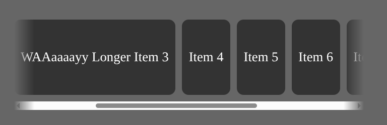

# Overflow masks on scroll

Fade the edges of a horizontally scrollable container when content overflows left, right, or both. Masks update on scroll so users see there is more content off-screen.



## Files

- `example.html`: full demo (CSS, markup, and scroll logic).
- `example.png`: screenshot with left and right masks active.

## Try it

Open `example.html` in a browser (or serve the folder with any static file server) and scroll the row of items.

## How it works

1. Detect horizontal overflow with `scrollLeft`, `scrollWidth`, and `clientWidth`.
2. Toggle CSS classes on the scroll container:
   - `overflow-mask-left` — content hidden to the left
   - `overflow-mask-right` — content hidden to the right
   - `overflow-mask-both` — overflow on both sides (scrolled to the middle)
3. Each class applies a `mask-image` linear gradient so content fades at the edge.

## CSS

Adjust `1.5rem` to change fade width.

```css
.overflow-mask-left {
  mask-image: linear-gradient(to left, black calc(100% - 1.5rem), transparent 100%);
}

.overflow-mask-right {
  mask-image: linear-gradient(to right, black calc(100% - 1.5rem), transparent 100%);
}

.overflow-mask-both {
  mask-image:
    linear-gradient(to left, black calc(100% - 1.5rem), transparent 100%),
    linear-gradient(to right, black calc(100% - 1.5rem), transparent 100%);
}
```

The scroll container needs horizontal overflow, for example:

```css
.overflow-items-container {
  display: flex;
  overflow-x: auto;
  overflow-y: hidden;
}
```

## JavaScript

```javascript
function getHorizontalOverflow(el) {
  const isOverflowingRight = el.scrollWidth > el.clientWidth + el.scrollLeft;
  const isOverflowingLeft = el.scrollLeft > 0;

  return {
    left: isOverflowingLeft,
    right: isOverflowingRight,
  };
}

function updateOverflowMasks(el) {
  const overflow = getHorizontalOverflow(el);

  if (overflow.left && overflow.right) {
    el.classList.add("overflow-mask-both");
  } else {
    el.classList.remove("overflow-mask-both");
  }

  el.classList.toggle("overflow-mask-left", overflow.left);
  el.classList.toggle("overflow-mask-right", overflow.right);
}

const container = document.querySelector(".overflow-items-container");

container.addEventListener("scroll", () => updateOverflowMasks(container));
updateOverflowMasks(container);
```

Call `updateOverflowMasks` again on `resize` if the container width can change.

## Markup

```html
<div class="overflow-items-container">
  <div class="item">Item 1</div>
  <div class="item">Item 2</div>
  <!-- ... -->
</div>
```

## Notes

- Uses CSS `mask-image`.
- Mask color is tied to opacity (`black` / `transparent`), not your page background color — works on solid or simple backgrounds; on busy backgrounds you may need a different approach.
- Logic is horizontal only; vertical overflow would use `scrollTop` / `clientHeight` the same way.
